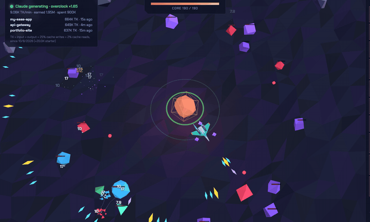
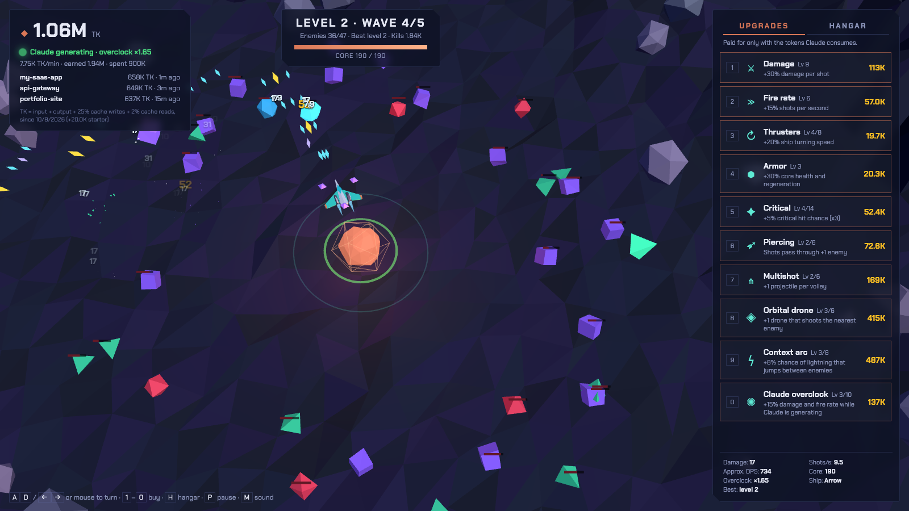
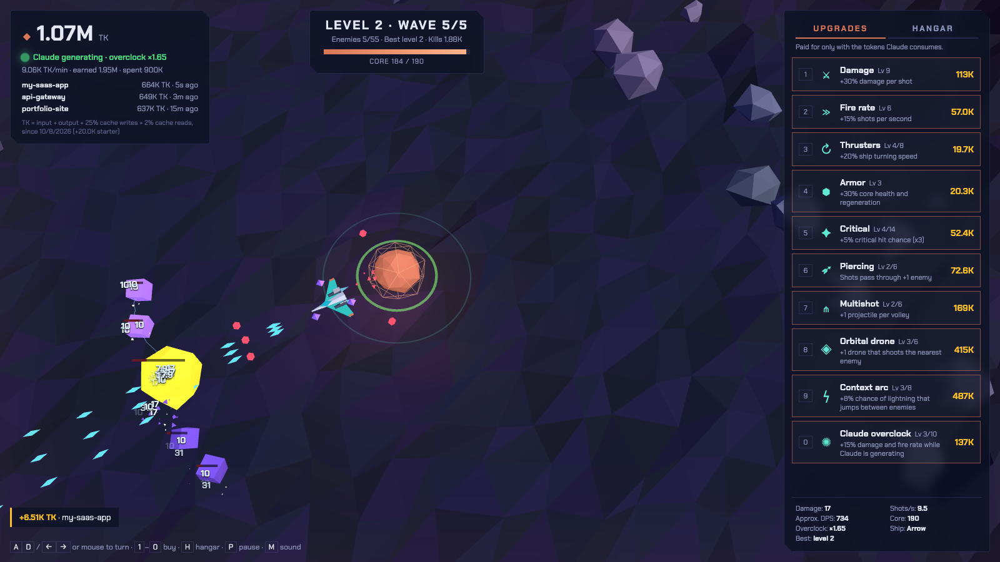
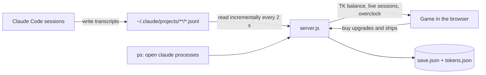
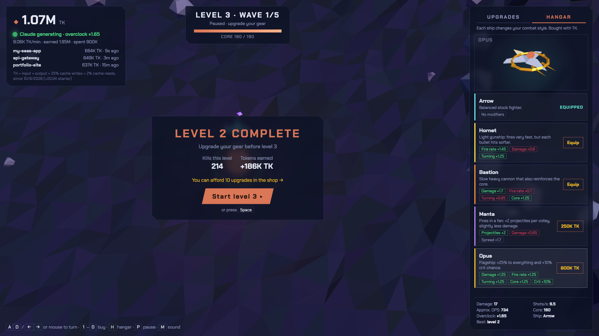
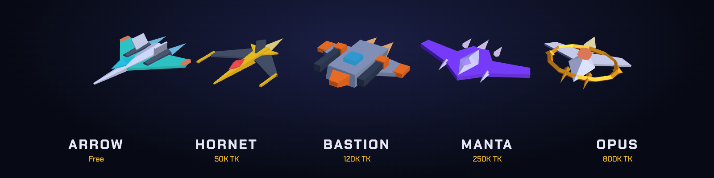

<div align="center">

# ◆ CONTEXT SIEGE

**An incremental orbital defense game where the only currency is the tokens Claude Code burns.**

Code with Claude → earn TK → upgrade your fleet → push deeper into the siege.




</div>

---

## Why I built this

I built it because I was bored waiting for Claude to finish the tasks I sent it.

So I turned the wait into the game itself: the longer Claude works, the more tokens it burns, and the stronger my fleet gets. Now, while Claude is busy, I have something to do, and the waiting even pays off.

## The idea

Enemies circle your core in rings and, like classic Space Invaders, every few seconds they step forward and reverse direction. Except here they step **toward the center**.

At the start they're brutally tough. You can't grind your way out: **every upgrade is paid for with tokens consumed by your real Claude Code sessions**. The more Claude works, the more you can spend. And while Claude is actively generating, your ship gets an **overclock** boost.

<table>
  <tr>
    <td></td>
    <td></td>
  </tr>
  <tr>
    <td align="center"><sub>Mid-wave: drones, crits and piercing shots</sub></td>
    <td align="center"><sub>Boss fight: it calls an escort at half health</sub></td>
  </tr>
</table>

## Quick start

```bash
git clone https://github.com/roberottt/contextsiege.git
cd contextsiege
npm start
```

Then open **http://localhost:4321**. You start with 20K TK. Everything else comes from Claude.

> **Requirements:** Node 18+, [Claude Code](https://claude.com/claude-code) installed and used on the same machine, and an internet connection (Three.js and the font load from a CDN).

## How it works



- A tiny local **Node server** (no dependencies) tails Claude Code's transcripts, deduplicates responses by `message.id` and adds up the tokens used **since you started playing**.
- Tokens are converted into **TK**, weighted so a long cached conversation doesn't break the economy:

  | Token type | Weight |
  |---|---|
  | Input | × 1 |
  | Output | × 1 |
  | Cache writes | × 0.25 |
  | Cache reads | × 0.02 |

- **Diminishing returns** keep parallel sessions in check: in every 10-minute window, the first 100K TK count in full and anything above grows with the square root (4× the tokens → 2× the TK). A single session rarely hits the cap; ten agents running at once do, and the HUD shows a *Saturated* warning with your current efficiency.
- It also detects open `claude` processes. If Claude produced tokens in the last 90 seconds, **overclock** kicks in.
- Purchases are validated server-side. Progress lives in `save.json`; earned TK live in `tokens.json`, together with read offsets, so they survive restarts and Claude Code cleaning up old conversations without ever being counted twice.

## Playing

| Key | Action |
|---|---|
| `A` `D` / `←` `→` / mouse | Rotate your ship around the orbit |
| `1` … `0` | Buy upgrades |
| `H` | Toggle the hangar |
| `Space` / `Enter` | Start the next level |
| `P` | Pause |
| `M` | Mute |

Your ship fires automatically and **blocks enemy bullets** with its hull. If enemies slip inside your orbit, it turns around and fires inward.

- **Levels** are 5 waves each. The 5th is a **boss** that calls an escort when it drops below half health.
- Between levels the game **pauses** so you can spend your TK. If the core falls, you retry the same wave, and nothing is lost.
- Enemy damage to the core grows with every level.

| Enemy | |
|---|---|
| 🟪 Cube | The baseline invader |
| 🟩 Tetrahedron | Fragile but fast, drifts along its ring |
| 🟥 Octahedron | Tanky, and shoots at the core |
| 🟦 Icosahedron | Splits into two tetrahedrons when destroyed (wave 6+) |
| ✨ Elite | Any enemy can spawn glowing: 3× health, 2× core damage (wave 4+) |
| 🟨 Boss | Every 5th wave. Fires spreads and summons an escort |

<div align="center">
  
  <br><sub>Level complete: spend your TK in the shop or the hangar before moving on</sub>
</div>

## Upgrades

| | Upgrade | Effect |
|---|---|---|
| ⚔ | Damage | +30% damage per shot |
| ≫ | Fire rate | +15% shots per second |
| ↻ | Thrusters | +20% turning speed |
| ⬢ | Armor | +30% core health and regeneration |
| ✦ | Critical | +5% chance of a ×3 critical hit |
| ➶ | Piercing | Shots pass through +1 enemy |
| ⋔ | Multishot | +1 projectile per volley |
| ◈ | Orbital drone | +1 drone that shoots the nearest enemy |
| ϟ | Context arc | Chance of lightning that jumps between enemies |
| ✺ | Claude overclock | Stronger boost while Claude is generating |

Costs scale exponentially. Above the fire rate cap, extra fire rate turns into damage.

## Hangar

<div align="center">
  
</div>

Each ship has its own model, bullet color, firing sound and stat modifiers. Preview them spinning in the hangar before you buy.

| Ship | Price | Style |
|---|---|---|
| **Arrow** | Free | Balanced stock fighter |
| **Hornet** | 50K TK | Fire rate ×1.45, turning ×1.25, damage ×0.8 |
| **Bastion** | 120K TK | Damage ×1.7, core ×1.25, fire rate ×0.7 |
| **Manta** | 250K TK | +2 projectiles in a wide fan, damage ×0.85 |
| **Opus** | 800K TK | +25% to everything and +10% crit chance |

## Privacy

- Everything runs **on your machine**. The server only listens on `127.0.0.1` and only accepts requests addressed to `localhost`, so other websites can't read your data or spend your TK.
- From the transcripts, the server only uses token counts, timestamps, model names and project folder names. Your conversations are never stored or sent anywhere.
- `save.json` and `tokens.json` are git-ignored. Don't share them: `tokens.json` contains the paths of your projects.

## Project structure

```
server.js           Local server: token tracking, Claude detection, purchases, saves
public/
  index.html        UI and styles
  game.js           The game (Three.js, low-poly, flat shading)
  upgrades.js       Upgrade catalog and stat formulas (shared with the server)
  ships.js          Ship catalog (shared with the server)
docs/               README images
```

## FAQ

**How do I start over?** Stop the server and delete `save.json` and `tokens.json`.

**Can I change the port?** `PORT=5000 npm start`. Use `CLAUDE_PROJECTS_DIR` to point at a different transcripts folder.

**Does it work on Windows?** Token tracking should work, but detecting open Claude sessions relies on `ps`, so the "sessions open" indicator won't. It's untested there.

**Why can't I host it online for friends?** The game counts the tokens of whoever runs the server, by reading their local Claude Code transcripts. Each player runs their own copy.

## Contributing

Ideas, bug fixes and new ships are welcome! Fork the repo and open a pull request against `main`. Direct pushes are restricted, and every pull request is reviewed and merged by the maintainer.
